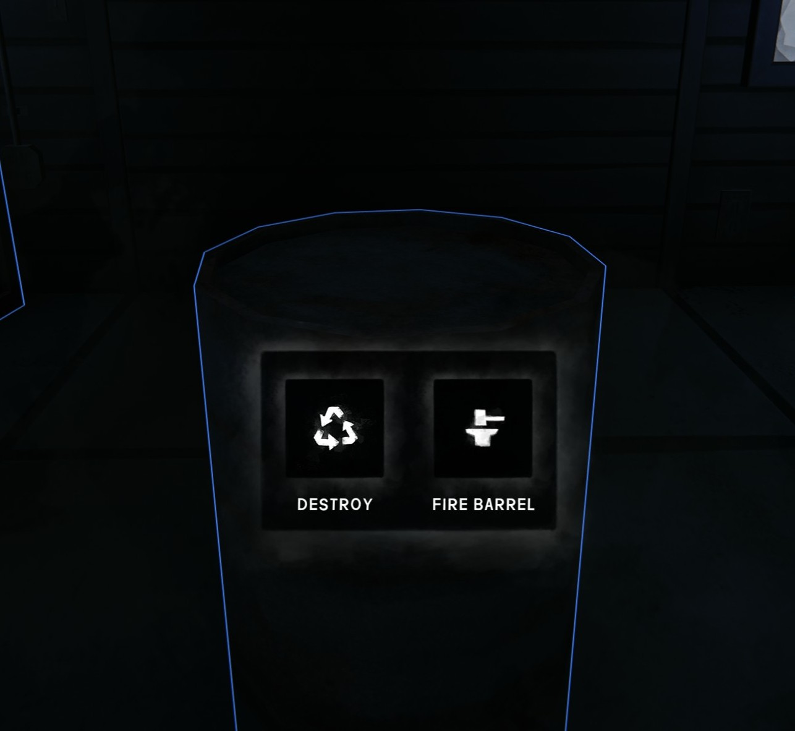

# FireBarrelCrafting (The Long Dark / MelonLoader)

Turn a decorative metal barrel (`OBJ_MetalBarrelA`) into a working vanilla fire barrel.



## Usage
* Interact with a decorative metal barrel: a wheel opens with **Destroy** (vanilla) and **Fire Barrel** (craft).
* Requires a **Hacksaw**, **Hatchet** or **Improvised Hatchet** in your inventory (the best-condition one is used
  and loses 10% condition). Takes 60 in-game minutes. Items stacked on the barrel must be removed first.

## Safe to uninstall
Barrels you never converted are untouched. A converted barrel is the game's own `INTERACTIVE_FireBarrel`,
saved by the game's placement system, so it stays after the mod is removed (only the fire's burn state may reset).

## How it works
* The decorative barrel is removed through the game's own `BreakDown.DoBreakDown` (saved by the game).
* The vanilla prefab `Assets/Prefabs/Interactive/INTERACTIVE_FireBarrel.prefab` is spawned via Addressables,
  aligned to the old barrel's bottom and registered with `PlaceableManager`, so the game saves and re-creates it.
* Spawned barrels get guids starting with `fbc0ffee`; on load the mod restores their `ObjectGuid`s
  so the fire's fuel/burn state persists.

## Settings
`UserData/MelonPreferences.cfg`, section `[FireBarrelCrafting]`:

| Key | Default | Meaning |
| --- | --- | --- |
| `AllowedTools` | `GEAR_Hacksaw,GEAR_Hatchet,GEAR_HatchetImprovised` | Any one of these is required |
| `ToolConditionLossPercent` | `10` | Tool wear per conversion, % of max condition |
| `CraftMinutes` | `60` | In-game minutes the conversion takes |
| `BarrelNamePrefixes` | `OBJ_MetalBarrelA` | Which decorative barrels can be converted |
| `VerboseLogging` | `false` | Extra diagnostics in `MelonLoader/Latest.log` |

## Project layout

```
src/FireBarrelCrafting/
  Mod.cs              entry point + composition root
  Configuration/      MelonPreferences settings, list parsing
  Conversion/         what a convertible barrel is, tools, the conversion workflow
  Spawning/           fire barrel factory, save registration, guid scheme, ground alignment
  Interaction/        the Destroy / Fire Barrel wheel
  Patches/            thin Harmony adapters into the game
  Infrastructure/     logging, player-facing text, compiler shim
tests/FireBarrelCrafting.Tests/   MSTest + FluentAssertions: pure logic and constructor guards
build/GameReferences.props        game / MelonLoader references shared by both projects
```

## Build & test
Requires the .NET SDK 10 and the game with MelonLoader 0.7.x run once (to generate `Il2CppAssemblies`).

    dotnet build FireBarrelCrafting.slnx -c Release                                  # also copies the DLL to <game>\Mods
    dotnet build FireBarrelCrafting.slnx -c Release -p:TLDDir="E:\Games\TheLongDark"   # other install path
    dotnet build FireBarrelCrafting.slnx -c Release -p:CopyToMods=false              # don't copy
    dotnet test  FireBarrelCrafting.slnx -c Release

Output: `src/FireBarrelCrafting/bin/Release/FireBarrelCrafting.dll`. Built against TLD 2.60 / MelonLoader 0.7.4.

## License
[MIT](LICENSE) © 2026 VolodymyrLobachov. The license covers this mod's source code only.
The Long Dark and its assets belong to Hinterland Studio; screenshots are from the game.
This mod is not affiliated with or endorsed by Hinterland.
