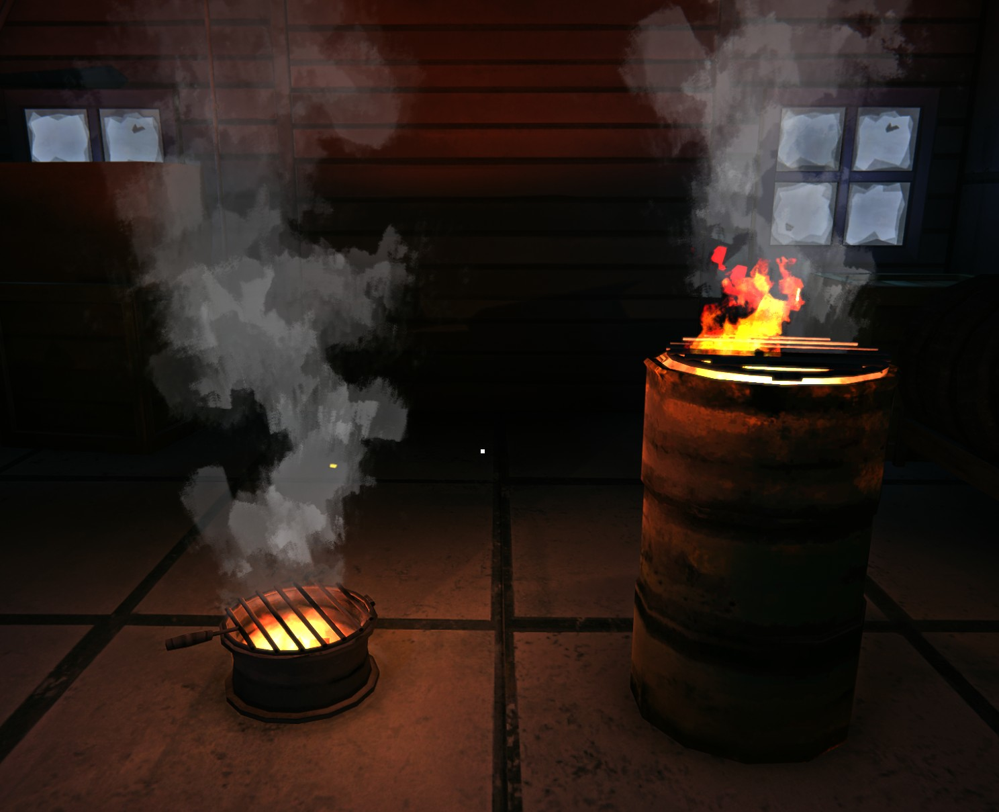
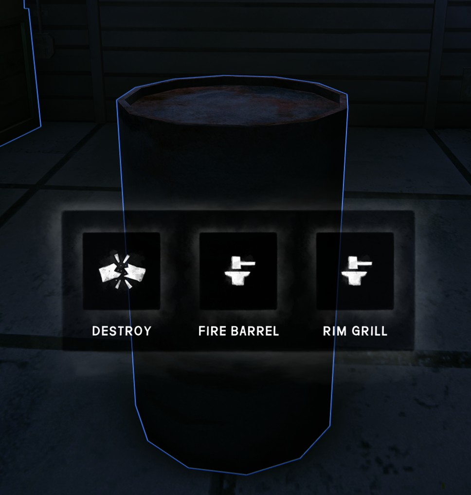

# FireBarrelCrafting (The Long Dark / MelonLoader)

Turn a decorative metal barrel (`OBJ_MetalBarrelA`) into a working vanilla fire barrel or rim grill.
Plastic barrels can't be converted.



## Usage
* In your safehouse's edit mode, select a decorative metal barrel: next to the vanilla actions
  (e.g. **Destroy**) there are **Fire Barrel** and **Rim Grill** actions.

  

* Requires a **Hacksaw**, **Hatchet** or **Improvised Hatchet** in your inventory (the best-condition one is used
  and loses 10% condition). Takes 60 in-game minutes. Items stacked on the barrel must be removed first.

## Requirements
* The Long Dark 2.60, MelonLoader 0.7.x
* [ModSettings](https://github.com/DigitalzombieTLD/ModSettings)

## Uninstalling
Barrels you never converted are untouched. A converted barrel is the game's own `INTERACTIVE_FireBarrel` or `INTERACTIVE_RimGrill`,
saved by the game's placement system, so it stays in your save and keeps working after the mod is removed
(only the fire's burn state may reset).

**Rim grills can no longer be moved without this mod.** The vanilla rim grill prefab lets its rack and cooking slots
take the click in edit mode, and the mod corrects that on every load. Fire barrels are not affected.
* Place your rim grills where you want them before uninstalling.
* To move one later, reinstall this mod or install Safehouse Customization Plus, which also lets you move it.

## How it works
* The decorative barrel is removed through the game's own `BreakDown.DoBreakDown` (saved by the game).
* The vanilla prefab `Assets/Prefabs/Interactive/INTERACTIVE_FireBarrel.prefab` (or `INTERACTIVE_RimGrill.prefab`) is spawned via Addressables,
  aligned to the old barrel's bottom and registered with `PlaceableManager`, so the game saves and re-creates it.
* Spawned objects get guids starting with `fbc0ffee`; on load the mod restores their `ObjectGuid`s
  so the fire's fuel/burn state persists.

## Settings
In game: **Options → Mod Settings → Fire Barrel Crafting**. Saved to `Mods/FireBarrelCrafting.json`.

| Setting | Default | Meaning |
| --- | --- | --- |
| Hacksaw / Hatchet / Improvised Hatchet | on | Tools that can be used (any one is required) |
| Prybar | off | Also allow the prybar |
| Tool wear (%) | `10` | Tool wear per conversion, % of max condition |
| Craft time (minutes) | `60` | In-game minutes the conversion takes |
| Verbose logging | off | Extra diagnostics in `MelonLoader/Latest.log` |

Settings moved here from `UserData/MelonPreferences.cfg` in 1.1.0; values changed in 1.0.0 need to be set again.

## Project layout

```
src/FireBarrelCrafting/
  Mod.cs              entry point + composition root
  Configuration/      ModSettings menu settings
  Conversion/         what a convertible barrel is, tools, the conversion workflow
  Spawning/           fire factory (fire barrel, rim grill), save registration, guid scheme, ground alignment
  Interaction/        the Fire Barrel / Rim Grill wheel entries
  Patches/            thin Harmony adapters into the game
  Infrastructure/     logging, player-facing text, compiler shim
tests/FireBarrelCrafting.Tests/   MSTest + FluentAssertions: pure logic, settings (incl. ModSettings' own field validation), constructor guards
build/GameReferences.props        game / MelonLoader references shared by both projects
```

## Build & test
Requires the .NET SDK 10, the game with MelonLoader 0.7.x run once (to generate `Il2CppAssemblies`)
and ModSettings in `<game>\Mods`. The version is set only in `<Version>` of the project file.

    dotnet build FireBarrelCrafting.slnx -c Release                                  # also copies the DLL to <game>\Mods
    dotnet build FireBarrelCrafting.slnx -c Release -p:TLDDir="E:\Games\TheLongDark"   # other install path
    dotnet build FireBarrelCrafting.slnx -c Release -p:CopyToMods=false              # don't copy
    dotnet test  FireBarrelCrafting.slnx -c Release

Output: `src/FireBarrelCrafting/bin/Release/FireBarrelCrafting.dll`. Built against TLD 2.60 / MelonLoader 0.7.4.

## License
[MIT](LICENSE) © 2026 VolodymyrLobachov. The license covers this mod's source code only.
The Long Dark and its assets belong to Hinterland Studio; screenshots are from the game.
This mod is not affiliated with or endorsed by Hinterland.
